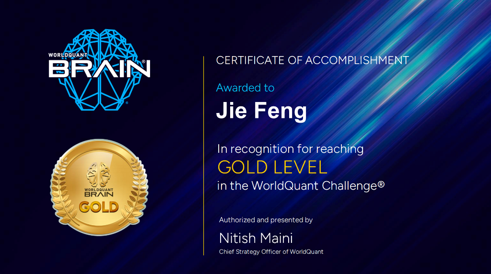

  <strong>English</strong> |
  <a href="README_CN.md">简体中文</a>

## About Me

  
  
  
  
  

I am a **Big Data Engineer** specializing in quantitative research infrastructure, data pipelines, and AI-driven trading systems.

Dedicated to building practical, end-to-end quantitative infrastructures that seamlessly integrate the entire research and trading lifecycle.

> **Ultimate Vision**: Powered by Autonomous Reasoning & Control (ARC) principles, my ultimate goal is to engineer self-evolving, autonomous agent systems capable of independent exploration, continuous strategy discovery, and adaptive execution within highly complex financial environments.

### Core Infrastructure & Technical Stack

  
  
  
  
  
  
  
  
  
  
  
  
  

- **Real-Time Streaming**: `Apache Flink` · `Kafka` · `Tick/Bar Streaming` · `Flink SQL` · `Large-State Checkpoint Tuning`
- **PB-Scale DWH & Batch Processing**: `Apache Spark` · `Hive` · `Hadoop` · `ODS ➔ DWD ➔ DWS Layered DWH`
- **Workflow Scheduling & Governance**: `Airflow` · `In-House Distributed Scheduler` · `1,000+ Job DAG Governance` · `SLA Monitoring & Recovery`
- **Storage, Analytics & Execution**: `ClickHouse` · `HBase` · `PostgreSQL` · `MySQL` · `Execution Gateways` · `Risk Controls`

---

## 🏆 Achievements

  
  

- 🥇 **[WorldQuant Challenge®](https://platform.worldquantbrain.com/profile/public/FJ90804)** — **Gold Level** (10,000+ Points)
  - Successfully accumulated **10,000+ points** by engineering high-Sharpe, market-neutral, and low-correlation quantitative alpha models on WorldQuant BRAIN.
  - Earned official qualification and invitation for the **Research Consultant** role.
  - Authorized and presented by **Nitish Maini**, Chief Strategy Officer of WorldQuant.
   
  

    
📜 <b>View Certificate of Accomplishment</b>

     
    
  

- 🥉 **[RSNA Knee Abnormality Detection (Kaggle)](https://www.kaggle.com/competitions/rsna-knee-abnormality-detection)** — **Bronze Medal** (Rank **558** / 6,299 · **Top 8.9%**)
  - Multi-label multimodal 3D knee MRI abnormality detection across 12 clinical findings.
  - Achieved a **+248 rank leap** on the private leaderboard (from 806th Public to 558th Private) through robust multi-instance learning (MIL) and calibrated model ensembling.

---

## What I'm Building & Exploring

I am actively building and exploring practical systems around autonomous reasoning, quantitative strategy discovery, and real-world product engineering:

### Autonomous Agents & Program Synthesis

#### [HyperTrade](https://github.com/Shadowell/HyperTrade)

A production-grade, governed quantitative research and strategy incubation Agent Runtime powered by the universal **ARC (Autonomous Research Core)** engine:

- **MCTS & MAP-Elites Search Engine**: Combines Monte Carlo Tree Search over strategy code ASTs with Quality-Diversity grid archiving to explore high-dimensional strategy spaces without premature convergence.
- **Adversarial Red-Teaming**: Blue Team quant agents formulate Alpha hypotheses while Red Team agents stress-test for black swan shocks, liquidity traps, and stop-loss vulnerabilities.
- **Multi-Regime Causal Attribution & Reflexion**: Deconstructs performance across market regimes (trending, volatile, range-bound) and distills structured negative constraints for continuous prompt feedback.
- **Voyager-Style Skill Distillation & Paper Trading**: Automatically distills validated code sub-functions into an immutable skill library, deploying robust candidate strategies to paper trading environments zero-touch.

#### [HyperARC](https://github.com/Shadowell/HyperARC) · Private Research

**Competitions:** [ARC-AGI-2 (Kaggle)](https://www.kaggle.com/competitions/arc-prize-2026-arc-agi-2) · [ARC-AGI-3 (Kaggle)](https://www.kaggle.com/competitions/arc-prize-2026-arc-agi-3) · [ARC Prize 2026](https://arcprize.org/competitions/2026)

An autonomous program synthesis and AGI reasoning research system designed for the full ARC-AGI benchmark suite (ARC-AGI-1/2 program synthesis and ARC-AGI-3 interactive-Agent experiments):

- **Grid-Transformation DSL & MCTS Solver**: 2D spatial primitives (`rotate_90`, `flip_horizontal`, `replace_color`, `crop_bounding_box`) combined with multi-threaded AST search (`HyperARCParallelMCTSEngine`).
- **Exact-Match Validation**: Self-healing harness scaffolding (`HyperARCHarness`) enforcing 100% pixel-exact matching on training grid examples before predicting unseen test grids.
- **Visual-State Abstraction & Trajectory Evaluation**: State abstraction, action history backtracking, skill routing, and trajectory-based evaluation.

### Quantitative Research & Infrastructure

- **[Alpha](https://github.com/Shadowell/Alpha)** — Self-evolving A-share stock selection system combining Kronos K-line forecasting models, Hermes Agent loops, and a three-pool funnel workflow.
- **[StockPro](https://github.com/Shadowell/StockPro)** — Real-time A-share research and monitoring platform covering real-time market data, AI stock evaluation, factor research, strategy development, and simulation trading.
- **[QuantBase](https://github.com/Shadowell/QuantBase)** — Open-source quantitative research workbench focused on real market data, backtesting, paper trading, signal audit, and risk-first strategy development.

### Independent Products

#### [配料君 (WeChat Mini Program)](#%E5%B0%8F%E7%A8%8B%E5%BA%8F%3A%2F%2F%E9%85%8D%E6%96%99%E5%90%9B%2FBxq9NHM7YIjXgxe)

A food-ingredient analysis and health-literacy mini program that I continuously operate and improve, covering data organization, product iteration, and promotion through WeChat Search.

This product is continuously operated and iterated—not a one-off demo.
